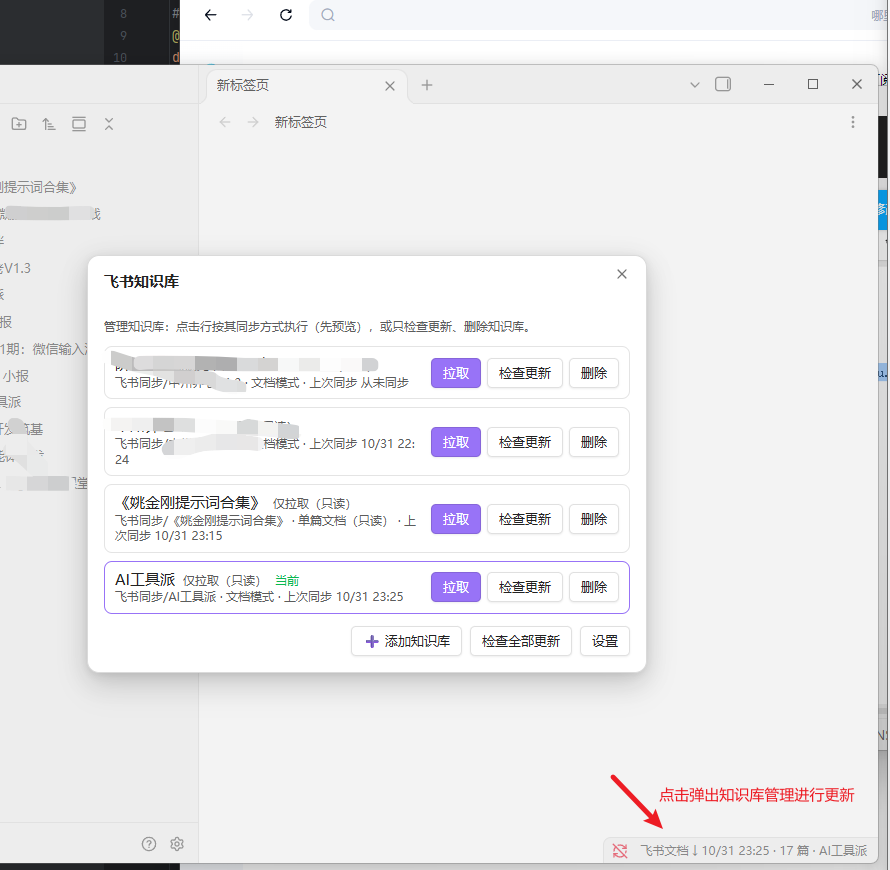
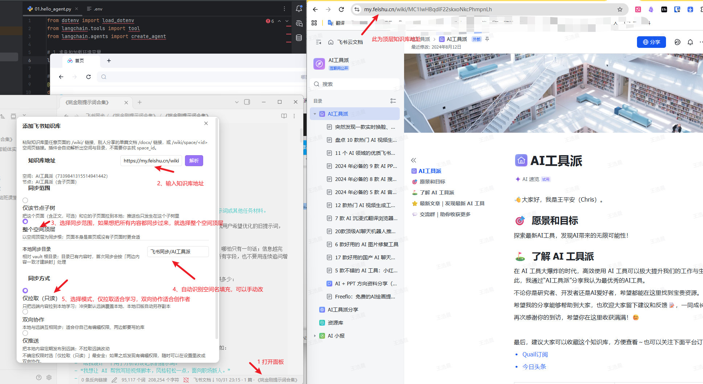

# Feishu Wiki Sync

> [!NOTE]
> **本仓库是 [chenqaq123/ObsidianSync](https://github.com/chenqaq123/ObsidianSync) 的二次开发版本**，不是官方发布渠道。在上游 0.1.2 的基础上做了若干增强；感谢上游作者的工作。本仓库的 [Releases 页面](https://github.com/wsa0227/feishu-sync-double/releases)提供二开版本的安装包。

将 Obsidian 仓库中的 Markdown 笔记与飞书知识库双向同步。当前维护版 **0.2.2**；[本仓库下载](https://github.com/wsa0227/feishu-sync-double/releases)。

仅支持 **Obsidian 桌面版 1.13.7 及以上**，连接中国版飞书（`open.feishu.cn`）。当前不包含 Notion、飞书多维表格或国际版 Lark 接入。本二开版本已上架 **Obsidian 社区插件市场**（独立 ID：`feishu-sync-double`），插件内直接搜索安装。

## English

**Feishu Wiki Sync Double** is a desktop Obsidian plugin that keeps your vault in sync with Feishu wikis. Paste a link to a shared wiki or a single shared document and the whole tree lands locally as Markdown — content, images, and folder structure included. A status-bar panel manages multiple wikis at once: "check updates" is fetch-only (changes get flagged before anything is pulled), so you can pull one wiki or all of them with one click. Wikis you own can sync both ways — notes written in Obsidian publish straight back to Feishu docs. Conflict-safe by default: nothing is deleted silently, and overwritten work is backed up. Free and open source.

Full illustrated guide: [docs/使用步骤.md](docs/使用步骤.md) (Chinese).

## 为什么做这件事

我的主要资料消费在飞书知识库里：别人的公开知识）、朋友持续更新的单篇分享文档。这些内容我最终要在 Obsidian 里结合AI使用，贴合个人使用习惯——手动复制粘贴又慢又乱，复制完就过期；飞书自带的导出是 PDF，创建副本也不支持知识库，进了 Obsidian 只能当附件看。

上游插件打通了"Obsidian ↔ 飞书"的通路，但按"一次同步一个库"设计，且不支持子目录拉取，实际长期用下来卡在三件事上：

1. 知识库多层级目录不能一键拉取所有正文图片
2. **多个库管不过来**：我有十几个知识库要跟，每次换库都得回设置改空间、改目录，改一次清一次同步进度，等于每个库都在反复"首次对接"。
3. **只读库误推**：别人的库我只有读权限，插件却默认双向同步——点一下就是向只读库发一批上传，全数报错。
4. **单篇分享文档同步不了**：别人发来的 `/docx/` 链接不在任何知识库里，插件只认知识库树，这种链接一个都拉不到。

所以这次二开的目标很具体：**把"跟读别人的知识库和文档"做成一件低维护的事**——加库像加书签一样简单，更新像收邮件一样自己挑着拉——同时不破坏上游那套同步安全设计（预览、冲突副本、不静默删东西）。

## 这个二开加了什么

**公开或者只读的知识库内容（仅拉取）**

- 别人的知识库：**粘贴知识库的分享链接**，简单几步整棵目录树拉成本地文件夹；作者更新后能跟进，冲突时远端覆盖，你的旧版本自动另存副本
- 别人的单篇文档：`/docx/` 分享链接只同步这一篇；飞书高亮块转成 Obsidian callout，文档引用块转成原文链接
- 不会误推：推送类操作在只读库上一律被拦截，不用惦记会不会误推

**多知识库面板**



- 右下角状态栏点击打开面板，所有知识库、同步方式、上次同步时间一屏看完
- 「检查更新」只探测不拉取（git fetch 语义）：有更新先标 `⬇ N 篇`，看完再决定拉哪个
- 单库拉取，或**一键拉取全部更新**；定时探测默认关闭
- 加新库不用改旧配置：粘贴链接 → 确认 → 首次预览，全程不需要理解 `space_id`

**自己写的内容**

- 双向协作：本地 Markdown 与飞书在线文档互相同步（含图片上传/下载）
- 仅推送：把本地笔记定期发布到飞书
- 文件镜像模式保留原始 Markdown 源码

**安全底线（继承上游并加强）**

- 默认不删除任何内容；删除必须在计划预览里单独确认
- 每次同步先弹计划，执行前逐项复核本地与远端是否又变过
- 冲突保留双方，远端版本存成副本，绝不静默覆盖

更完整的技术性差异清单见下方 [与上游的差异](#与上游的差异)。

## 现在达到了什么地步

已经能用、我自己在用的部分：

- 多知识库管理：面板切换、独立进度互不干扰，十几个库并存
- 更新检查：单库/全部检查，更新标识、单库拉取、一键全拉
- 单篇 `/docx/` 文档：拉取、图片本地化、callout/cite 转换、更新跟进
- 三档位方向控制（仅拉取/双向/仅推送）加误推拦截
- 设置页分组：授权等一次性配置收进抽屉，授权失效一键重授权
- 已上架 Obsidian 社区插件市场：插件内搜索 **Feishu Wiki Sync Double** 直接安装，更新自动推送
- `0.2.2` 已发布 [Release](https://github.com/wsa0227/feishu-sync-double/releases)

还没做的：

- 表格、多维表格、PDF 附件等内容**仍不同步**（会提示数量，但内容下不来）
- 单篇模式只支持新版文档 `/docx/`，旧版 doc 和表格链接不行
- 冲突没有解决界面：副本生成后要自己在文件层面合并

## 使用步骤

**完整的图文步骤在这里：[docs/使用步骤.md](docs/使用步骤.md)** —— 安装、建飞书应用、授权、添加知识库、检查更新与拉取、冲突处理，每一步都有截图和说明。

快速上手：

1. Obsidian 里 **设置 → 第三方插件 → 浏览**，搜 **Feishu Wiki Sync Double**，安装并启用（也可从 [Releases](https://github.com/wsa0227/feishu-sync-double/releases) 下载 zip 手动装）
2. 在飞书开放平台建一个自建应用并授权（一次性，约 5-10 分钟）
3. 点右下角状态栏 → **添加知识库** → 粘贴链接



4. **检查更新** → 看到更新标识后拉取

飞书应用需要的权限与后台配置要点：

| 权限标识 | 插件用途 |
| --- | --- |
| `drive:drive` | 文件读写、查询元数据，以及用户开启后的删除传播 |
| `wiki:wiki` | 列出知识空间、读取和创建目录节点、移动文档到知识库 |
| `wiki:node:read` | 读取知识库节点信息，用于解析公开 `/wiki/...` 根节点链接 |
| `wiki:node:retrieve` | 按节点令牌取回知识库节点，支持公开链接对应的目录同步 |
| `docx:document` | 文档模式中的创建、读取、编辑文档与图片块 |
| `docs:document.media:download` | 下载文件和文档图片素材 |
| `docs:document.media:upload` | 文档模式上传图片素材 |
| `offline_access` | 用户授权后获取刷新凭证，维持登录 |

- 重定向地址（开发者后台「安全设置」里登记，必须逐字一致）：`http://localhost:7634/callback`
- 使用"用户授权"需开通用户身份权限；"应用身份"无需 `offline_access`，但要把应用加为知识库成员
- 授权过期用命令面板的「重新授权飞书账号」；回调页打不开时，把地址栏带 `code=` 的完整链接贴进"手动粘贴授权码"

## 隐私与网络访问

- **账户与费用**：插件本身免费，无广告或付费解锁；需要飞书账号、企业自建应用及目标知识库的访问权限。飞书自身的服务费用、容量和 API 配额由飞书决定。
- **联网范围**：`accounts.feishu.cn` 用于浏览器登录、授权和刷新令牌；`open.feishu.cn` 用于知识库、文档、文件及图片 API。下载可能由飞书重定向至其素材服务。文档中的外部图片链接会随正文发送给飞书，飞书可能按其规则加载这些链接。
- **上传内容**：同步范围内笔记的标题、目录与正文会传给所配置的飞书知识库；文档模式还上传笔记引用的本地图片。排除规则可缩小范围；第一次同步前应检查预览。文档会由飞书云服务处理和存储，包括文档模式使用的 `docs_ai` 接口。
- **本地存储**：App Secret、用户令牌和同步映射通过 Obsidian 插件配置保存，默认位置为 `.obsidian/plugins/feishu-sync-double/data.json`，未额外加密。自定义配置目录时，`data.json` 随 Obsidian 的配置目录存放；规则、冲突副本和调试日志仍位于仓库内 `.obsidian/feishu-sync/`。日志可能含笔记路径和接口错误信息，分享前请检查。
- **回调和文件访问**：自动授权临时监听本机回调端口，完成、取消或超时后关闭。插件运行时读写仓库内的笔记、附件与上述配置文件，不主动扫描仓库外的文件；“打开规则文件”仅将仓库内的规则文件交给系统默认程序。
- **数据收集**：插件没有开发者后台，不收集或发送遥测、统计及广告数据；不会自行安装或更新插件或依赖。联网同步仅用于用户配置的飞书服务。撤销本地授权不会删除飞书中已同步的文档。

## 选择同步模式

| 模式 | 飞书中保存的内容 | 适合用途 | 边界 |
| --- | --- | --- | --- |
| 文档模式 | 可阅读、可编辑的飞书新版文档 | 在 Obsidian 写作，在飞书阅读和协作 | 会转换排版，不保证 Markdown 源码逐字不变 |
| 文件镜像（默认） | 原始 `.md` 文件 | 保留原始 Markdown 内容 | 不上传附件，飞书侧的展示取决于 Markdown 文件预览 |

两种模式都支持预览、双向同步、单向推送/拉取和冲突副本。只同步 `.md` 笔记；文档模式会另行处理笔记引用的本地图片。

## 安装

### 方式一：从 Obsidian 插件市场安装（推荐）

打开 Obsidian 的 **设置 → 第三方插件 → 浏览**，搜索 **Feishu Wiki Sync Double**，安装并启用。之后的更新会随插件市场自动推送。

### 方式二：手动安装构建包

从 [本仓库 Releases](https://github.com/wsa0227/feishu-sync-double/releases) 下载最新版本（当前 `0.2.2`）：

1. 下载并解压 `feishu-sync-double-0.2.2.zip`，得到 `feishu-sync-double` 文件夹。
2. 关闭 Obsidian，将该文件夹放入目标仓库的 `.obsidian/plugins/` 下。最终应为：

   ```text
   你的仓库/
   └── .obsidian/
       └── plugins/
           └── feishu-sync-double/
               ├── main.js
               ├── manifest.json
               └── styles.css
   ```

3. 重启 Obsidian，在 **设置 → 第三方插件** 中关闭限制模式，启用 **Feishu Wiki Sync Double**。
4. 后续的授权与添加知识库步骤见 [docs/使用步骤.md](docs/使用步骤.md)。

> 从旧版（`feishu-wiki-sync` 手动安装）升级：插件文件夹名变了，把旧文件夹 `data.json` 复制到新文件夹即可保留全部知识库配置与同步进度；`.obsidian/feishu-sync/`（规则与冲突副本）不受影响。

### 从源码构建

需要 Node.js **20 或以上**及 npm。在本仓库目录运行：

```sh
npm ci
npm run package
```

`package` 依次进行版本检查、类型检查、全部离线测试、生产构建和打包。成功后输出：

```text
dist/
├── feishu-sync-double/
│   ├── main.js
│   ├── manifest.json
│   └── styles.css
├── feishu-sync-double-0.2.2.zip
└── SHA256SUMS
```

安装包只包含三个运行文件，不包含 TypeScript 源码、测试数据、账号或笔记。`main.js` 为可审阅的 JavaScript，内含项目及第三方许可声明。`SHA256SUMS` 提供文件和压缩包校验值。只需编译时运行 `npm run build`，输出安装目录并更新仓库根目录的 `main.js`。

也可在关闭 Obsidian 后直接安装到本地仓库：

```sh
npm run install:vault -- "/完整路径/你的仓库"
```

脚本会先构建，再检查仓库是否已有 `.obsidian` 目录，备份原有的三个安装文件到插件目录内的 `.backup-时间戳/`，最后替换文件；账号、映射与规则不变。没有指定路径时直接报错，不会猜测安装位置。也支持通过 `OBSIDIAN_VAULT` 指定仓库；自定义 Obsidian 配置目录可使用 `OBSIDIAN_CONFIG_DIR`（相对仓库路径）。

发布时必须让 GitHub Release 标签与 `manifest.json` 的 `version` 完全一致（例如 `0.2.2`），并分别上传 `main.js`、`manifest.json`、`styles.css`；ZIP 供手动安装使用，不能替代这三个附件。以后更新需同步修改 `package.json`、锁文件、`manifest.json` 和 `versions.json`，重新构建后创建新版本。发布元数据可用 `node scripts/check-release.mjs <版本号>` 预先校验。

## 与上游的差异

本仓库相对 [上游 0.1.2](https://github.com/chenqaq123/ObsidianSync/releases/tag/0.1.2) 的主要增强（均为文档模式）：

- **容器文档正文同步（folder-note 风格）**："有子页面的页面"自身的正文也会拉取为笔记，并放进与它同名的文件夹里（例如 `Day01. LangChain/Day01. LangChain.md`），本地树形与飞书一致；空的目录页面仍只当作目录，作者事后补写正文也能在下一轮自动拉取。
- **bookmark 书签块转链接**：新增下行规则 `bookmark-to-link`，把飞书的 `<bookmark …>` 网页书签块转成标准 Markdown 链接 `[标题](网址)`，不再在笔记里残留无法渲染的标签。
- **附件目录收进同步根目录**：文档模式的图片附件保存在 `本地同步目录/attachments/` 下（例如 `飞书同步/RAG智能体开发/attachments/`），跟随本次同步的根目录，而不是 vault 根目录。
- **首次对接不再误报带图冲突**：计划期与本地内容的比较按图片素材槽位归一，只拉取时重新对接带图文档不会再被误判成"两边内容不同"。
- **同名目录与同名笔记可共存**：路径撞车消解在空目录剔除之后进行，`X/` 目录与 `X.md` 笔记并存不再被误判为"远端路径歧义"。
- **添加知识库向导**：新命令「添加知识库」——粘贴任意 `/wiki/` 链接（节点页或 `/wiki/space/<id>` 空间页）或裸节点令牌，自动解析空间与节点，**一次确认**同步范围（节点子树 / 空间顶层）、本地目录（自动建议 `飞书同步/<空间名>`，可改）与同步档位，完成即进入首次预览。全程不需要理解 `space_id`。
- **多目标与同步档位**：支持多个同步目标（每个 = 空间 + 根节点 + 本地目录 + 档位），命令「切换同步目标」模糊搜索切换，状态栏显示当前目标与方向。三档位：**仅拉取（镜像）**（冲突默认远端覆盖本地、本地旧版自动另存副本；误推保护；本地是缓存语义）、**双向协作**（冲突保留双方）、**仅推送**。旧配置自动迁移为单一默认目标。
- **知识库面板与更新检查**：右下角状态栏打开管理面板，列出全部知识库；"检查更新"只探测不拉取（git fetch 语义），有更新先标识，再选择单库拉取或一键拉取全部更新；定时探测默认关闭。
- **单篇云文档同步**：粘贴别人分享的 `/docx/` 链接即可只同步这一篇（仅拉取），高亮块转 Obsidian callout、引用块转原文链接，作者更新可跟进。
- **设置页分组**：应用与授权等一次性配置收入默认收起的抽屉；新增"重新授权飞书账号"命令。
- 保留上游的同步安全防护（远端列表异常即停、预览保护、冲突副本等）与离线 e2e 测试，并新增容器同步、bookmark、附件目录、镜像档与重对齐等场景。

## 许可证与致谢

本项目采用 [MIT License](LICENSE)，是独立社区插件，与 Obsidian、飞书或 Lark 无官方隶属关系。

本仓库基于 [chenqaq123/ObsidianSync](https://github.com/chenqaq123/ObsidianSync)（MIT）二次开发，继承其许可证与版权声明，感谢上游作者的工作。飞书文档和图片接口实现参考了 [Lark CLI](https://github.com/larksuite/cli) 的请求格式与素材处理流程；上游版权及许可见 [第三方声明](THIRD_PARTY_NOTICES.md)，声明同时保留在发布的 `main.js` 中。构建工具和类型声明不打入插件运行文件。
